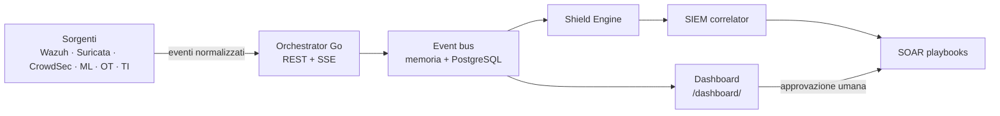

<div align="center">


**Un control plane di sicurezza difensivo, componibile e vendor-neutral.**
Una API Go, una dashboard e una serie di collector read-only che trasformano lo
stack difensivo open source in un unico flusso di lavoro locale.

[](#licenza)
[](core/orchestrator/go.mod)
[](modules)
[](#postura-di-sicurezza)

[Avvio rapido](#avvio-rapido) ·
[Screenshot](#screenshot) ·
[Moduli](#moduli) ·
[Architettura](#architettura) ·
[English](README.md)

</div>

---

## Cos'è Cybersecurity-AEGIS?

AEGIS non è l'ennesimo SIEM monolitico. È un **control plane sottile e
opinionato** che si appoggia a strumenti che già conosci — Wazuh, Suricata,
CrowdSec, MISP, Sigma, step-ca — e fornisce loro un modello eventi comune, una
dashboard unica e un modello di sicurezza prevedibile.

Tre principi guidano il progetto:

1. **Un solo modello eventi.** Ogni sorgente viene normalizzata nella stessa
   forma: un alert Suricata, una notifica Wazuh e una predizione ML si
   correlano tra loro senza codice di colla.
2. **Read-only di default.** I collector osservano. Le scritture sono opt-in,
   con gating e audit — sulle reti OT non si scrive nulla.
3. **Locale prima di tutto.** Nessun account cloud, nessuna telemetria, nessun
   control plane esterno: i dati restano sulla macchina che esegue la dashboard.

## Screenshot

<div align="center">

| Panoramica SOC | Shield Engine |
| :---: | :---: |
|  |  |
| Flusso eventi live, stato moduli, severità | Motore di detection, hit sulle regole, trend |

| Controllo OT | Threat Intelligence |
| :---: | :---: |
|  |  |
| Visibilità OT/ICS passiva, inventario protocolli | Registro IOC, salute dei feed, enrichment |

| Correlazione SIEM | Plant Assessment |
| :---: | :---: |
|  |  |
| Regole stile Sigma, correlazione temporale | Assessment di rete industriale read-only |

</div>

> Tutti gli screenshot provengono da un'**istanza locale popolata con eventi
> sintetici**. Nessun dato di clienti, produzione o personale è presente.

## Moduli

Ogni modulo è distribuibile in modo indipendente e parla lo stesso contratto
eventi. La tabella completa, con il dettaglio di ogni componente, è nel
[README inglese](README.md#modules).

| Modulo | Percorso | Funzione |
|---|---|---|
| **Orchestrator** | `core/orchestrator` | API REST + SSE in Go, dashboard embedded, health, metriche, event bus |
| **Shield Engine** | `core/orchestrator` | Motore di detection con regole JSON stile Sigma |
| **CyberShield AI** | `modules/ml` | Core ML/IDS: classificazione binaria e per famiglia, FastAPI su `:8919` |
| **SIEM Correlator** | `modules/siem` | Correlazione temporale, deduplica incidenti, rule pack Sigma |
| **SOAR** | `modules/soar` | Esecutore di playbook YAML, dry-run di default, gate di sicurezza OT |
| **Threat Intel** | `modules/threat_intel` | Registro IOC, feed MISP/OTX/AbuseIPDB, enrichment automatico |
| **Network Analyzer** | `modules/network` | Analisi traffico passiva, profilazione dispositivi, discovery LAN |
| **Vulnerability Scanner** | `modules/vuln` | Passivo prima di tutto, lookup NVD, correlazione servizio-CVE |
| **OT Monitor** | `modules/industrial/ot_monitor` | Parsing passivo Modbus / DNP3 / OPC UA / IEC 61850 / BACnet / Profinet |
| **Site Assessment** | `modules/industrial/site_assessment` | Assessment rete industriale con report in italiano |
| **Endpoint** | `modules/endpoint` | Audit host, file scanner, honeypot, containment, forensics |
| **DFIR** | `modules/dfir` | Gestione casi, timeline, catena di custodia |
| **Evidence Store** | `modules/evidence` | Archiviazione WORM con verifica SHA-256 |
| **Compliance** | `modules/compliance` | Check GDPR / NIS2 / OT, sola lettura |
| **PKI** | `modules/pki` | Integrazione step-ca / OpenSSL per certificati host, mTLS e SSH |

## Avvio rapido

### Opzione A — Windows standalone (senza Docker)

```powershell
.\start-aegis.ps1
```

Il launcher compila l'orchestratore Go, installa le dipendenze Python, avvia i
moduli core, porta su il modulo endpoint su `:8088` e apre
`http://localhost:8070/dashboard/`.

Per fermare tutto: `.\stop-aegis.ps1` oppure `Ctrl+C`.

| Flag | Effetto |
|---|---|
| `-NoEndpoint` | Salta il modulo endpoint |
| `-EndpointPort 9088` | Cambia la porta del modulo endpoint |
| `-NoBrowser` | Non apre il browser |

**Requisiti:** Python 3.10+ e Go 1.23+. Non esiste un binario precompilato nel
repository: l'orchestratore viene compilato in locale.

### Opzione B — Docker

```bash
cp .env.example .env        # imposta AEGIS_ADMIN_PASSWORD e le chiavi API
docker compose --profile full up --build -d
```

Oppure con gli installer: `bash install.sh` su Linux/macOS, `.\install.ps1` come
amministratore su Windows.

Porte, metodi di login, tool della dashboard e troubleshooting sono raccolti
nella [guida della control room](docs/control-room.md).

### Invio di un evento di prova

La piattaforma lavora su dati reali: non c'è un generatore di demo. Usa uno
qualsiasi degli endpoint `/api/v1/ingest/*`:

```powershell
Invoke-RestMethod -Uri http://localhost:8070/api/v1/ingest/generic `
  -Method POST -ContentType "application/json" `
  -Body '{"source":"manual","category":"system","severity":"high","title":"AEGIS test alert"}'
```

## Architettura



Dettaglio completo in [docs/architecture.md](docs/architecture.md).

## Postura di sicurezza

AEGIS è **solo difensivo**. Lo stack predefinito non include framework di
exploit, infrastrutture C2, strumenti di brute-force né manipolazione attiva di
impianti OT.

| Garanzia | Come viene applicata |
|---|---|
| Collector read-only | I percorsi di scrittura sono bloccati nel codice, non solo per policy |
| SOAR in dry-run | I playbook non agiscono finché non vengono esplicitamente armati |
| Protezione OT | Il monitoraggio industriale è opt-in via `docker-compose.industrial.yml` |
| Dati locali | Nessuna telemetria, nessun account cloud |

L'autenticazione della dashboard è **disattivata di default** per l'uso su
localhost: va abilitata prima di esporre il servizio. Dettagli e processo di
segnalazione in [SECURITY.md](SECURITY.md).

## Plant Assessment — lavoro sul campo

Modulo dedicato alla rete di un impianto: capire cosa è esposto e cosa può
essere comandato, **senza fermare la produzione**.

- **Passivo prima di tutto** — analizza un pcap/pcapng o una cattura da mirror
  port senza inviare un solo pacchetto.
- **Read-only sui protocolli di processo** — Modbus FC43, S7 Read SZL,
  EtherNet/IP ListIdentity, BACnet Who-Is/ReadProperty, SNMP GET, OPC UA Hello.
  Ogni funzione di scrittura è bloccata a livello di codice.
- **Rileva comandi di scrittura** osservati nel traffico (Modbus, S7, DNP3,
  IEC 104, BACnet, PROFINET DCP Set): il segnale più diretto di manipolazione o
  malware.
- **Report in italiano**, divisi tra interventi applicabili in produzione e
  interventi da pianificare in fermata, con MITRE ATT&CK for ICS e IEC 62443.
- **Baseline** nel tempo per scoprire device nuovi e porte comparse.

```powershell
cd modules\industrial
python -m site_assessment preflight
python -m site_assessment assess --site "Linea 2" --auth-ref "WO-2026-014" `
    --target 192.168.10.0/24 --pcap cattura.pcapng --out reports\linea2
python -m site_assessment selftest   # verifica installazione, nessuna rete
```

Guida completa: [docs/industrial-site-assessment.md](docs/industrial-site-assessment.md).

## Verifiche

```bash
cd core/orchestrator && go build ./... && go vet ./... && go test ./...
```

## Licenza e proprietà

Cybersecurity-AEGIS è opera originale e **proprietà esclusiva di El Moutaouakil
Tarik**, che ne detiene il copyright. La licenza concede un diritto d'uso: non
trasferisce la proprietà né assegna il copyright su alcuna parte del progetto.

Rilasciato con **AGPL-3.0 + Commons Clause** — testo integrale in
[LICENSE](LICENSE), proprietà e attribuzione in [NOTICE](NOTICE).

- Uso personale, di ricerca e difensivo interno gratuito.
- Ridistribuzione commerciale, embedding OEM e uso MSP multi-tenant richiedono
  una licenza commerciale scritta dell'autore: vedi [COMMERCIAL.md](COMMERCIAL.md).
- L'attribuzione all'autore va mantenuta in ogni copia, fork e opera derivata.

## Ringraziamenti

AEGIS esiste grazie alla community open source: Wazuh, Suricata, Zeek,
CrowdSec, MISP, OpenCTI, Sigma, StackStorm, Keycloak, PacketFence, step-ca,
Fleet, Greenbone, Velociraptor, open62541, pymodbus e molti altri.
