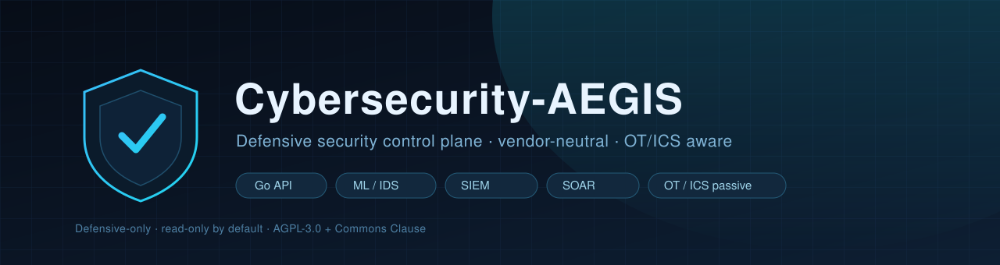
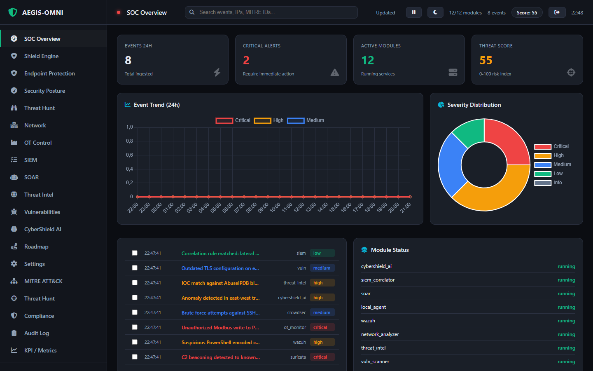
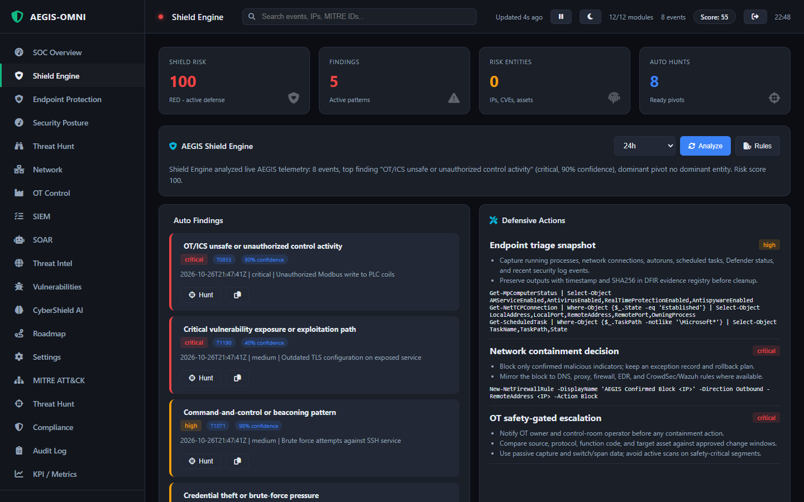
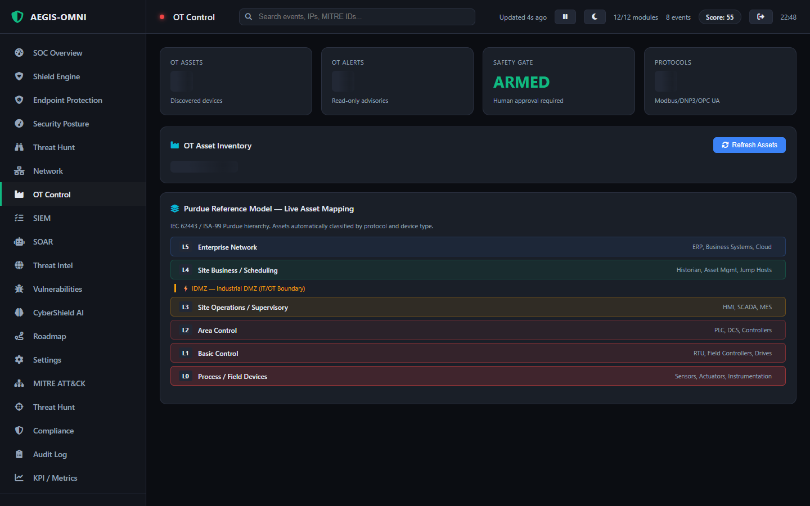
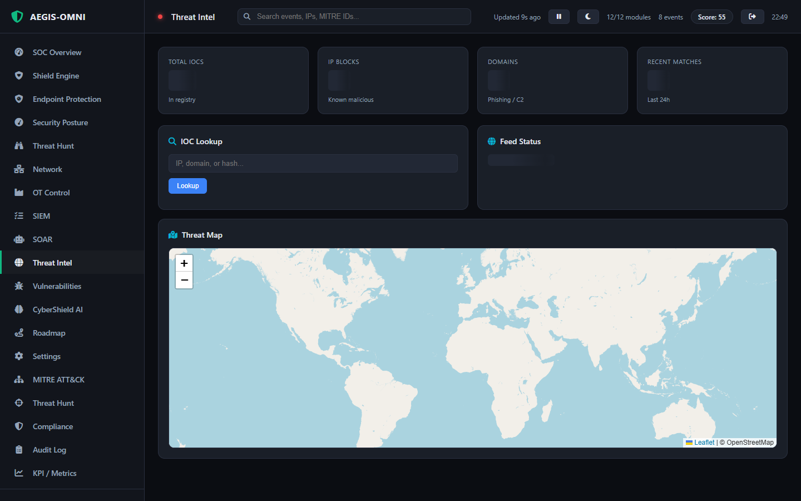
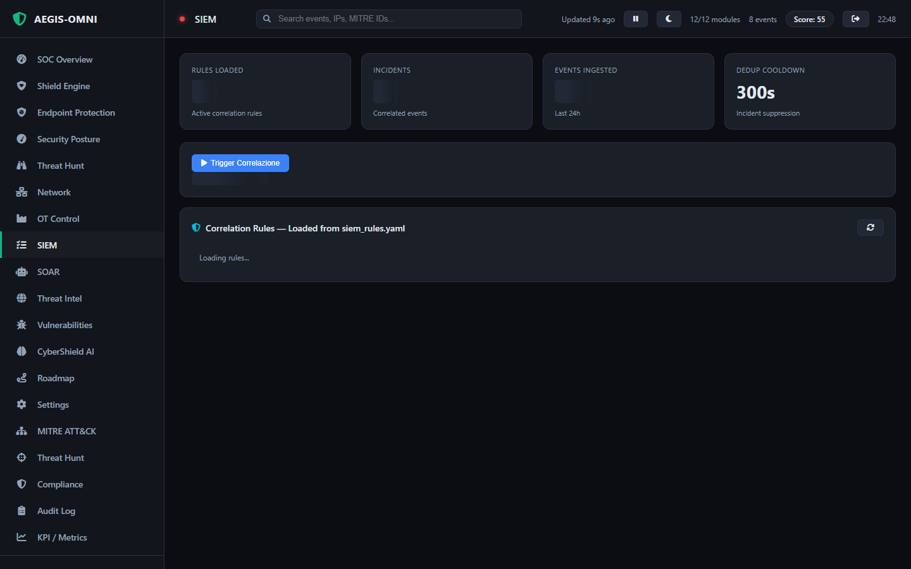
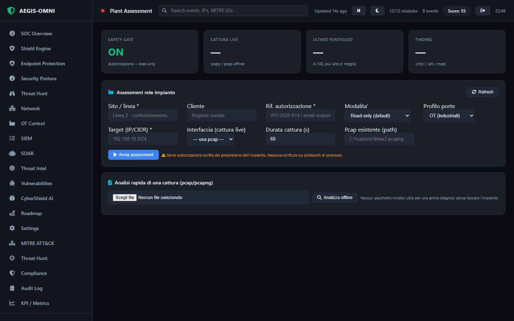
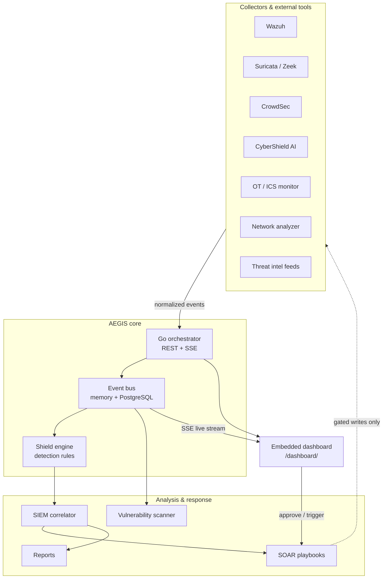

<div align="center">



**A composable, vendor-neutral defensive security control plane.**
One Go API, one dashboard, and a set of read-only collectors that turn the
open-source defensive stack into a single local workflow.

[](#license)
[](core/orchestrator/go.mod)
[](modules)
[](#safety-position)
[](#otics-safety)

[Quick start](#quick-start) ·
[Screenshots](#screenshots) ·
[Modules](#modules) ·
[Architecture](#architecture) ·
[API](#api-endpoints) ·
[Sicurezza](SECURITY.md) ·
[Italiano](README.it.md)

</div>

---

## What is Cybersecurity-AEGIS?

AEGIS is not another monolithic SIEM. It is a **thin, opinionated control plane**
that sits on top of tools you already trust — Wazuh, Suricata, CrowdSec, MISP,
Sigma, step-ca — and gives them a common event model, a single dashboard and a
predictable safety model.

Three ideas drive the design:

1. **One event model.** Every source is normalized into the same shape, so a
   Suricata alert, a Wazuh notification and an ML prediction correlate with each
   other without custom glue code.
2. **Read-only by default.** Collectors observe. Writes are opt-in, gated and
   audited — on OT networks nothing is written at all.
3. **Local first.** No cloud account, no telemetry, no external control plane.
   Data stays on the machine that runs the dashboard.

## Screenshots

<div align="center">

| SOC Overview | Shield Engine |
| :---: | :---: |
|  |  |
| Live event feed, module posture, severities | Detection engine, rule hits and trends |

| OT Control | Threat Intelligence |
| :---: | :---: |
|  |  |
| Passive OT/ICS visibility, protocol inventory | IOC registry, feed health, enrichment |

| SIEM Correlation | Plant Assessment |
| :---: | :---: |
|  |  |
| Sigma-style rules, temporal correlation | Read-only industrial network assessment |

</div>

> All screenshots come from a **local instance populated with synthetic sample
> events**. No customer, production or personal data appears in them. Caption
> details are in [docs/screenshots](docs/screenshots/README.md).

## Modules

Every module is independently deployable and speaks the same event contract.

| Module | Path | What it does |
|---|---|---|
| **Orchestrator** | `core/orchestrator` | Go REST + SSE API, embedded dashboard, health, metrics, event bus, optional PostgreSQL |
| **Shield Engine** | `core/orchestrator` | Detection engine with Sigma-style JSON rules and live hit tracking |
| **CyberShield AI** | `modules/ml` | ML/IDS core: binary + family classification, anomaly baseline, FastAPI on `:8919` |
| **SIEM Correlator** | `modules/siem` | Temporal correlation, incident deduplication, Sigma rule packs |
| **SOAR** | `modules/soar` | YAML playbook executor, dry-run by default, OT safety gates, audit trail |
| **Threat Intel** | `modules/threat_intel` | IOC registry, MISP/OTX/AbuseIPDB feeds, automatic enrichment |
| **Threat Fusion** | `modules/intelligence` | Multi-source scoring + YARA matching |
| **Network Analyzer** | `modules/network` | Passive traffic analysis, device profiling, LAN discovery |
| **Vulnerability Scanner** | `modules/vuln` | Passive-first, NVD CVE lookup, service-to-CVE correlation |
| **OT Monitor** | `modules/industrial/ot_monitor` | Passive Modbus / DNP3 / OPC UA / IEC 61850 / BACnet / Profinet parsing |
| **OT Protocol Collectors** | `modules/ot_protocols` | Read-only Modbus TCP and OPC UA telemetry (NIST SP 800-82 aligned) |
| **Site Assessment** | `modules/industrial/site_assessment` | On-site industrial network assessment with Italian reports |
| **Endpoint Protection** | `modules/endpoint` | Host audit and hardening, file scanner, honeypot, containment, forensics |
| **DFIR** | `modules/dfir` | Case management, timeline, evidence links, chain of custody |
| **Evidence Store** | `modules/evidence` | WORM evidence storage with SHA-256 verification |
| **Compliance** | `modules/compliance` | GDPR / NIS2 / OT readiness checks — read-only assessment |
| **PKI** | `modules/pki` | step-ca / OpenSSL integration for host, mTLS and SSH certificates |
| **Integrations** | `modules/integrations` | Read-only health probing of external OSS tools |
| **Reports** | `modules/reports` | Report generation for incidents, assessment and exec summaries |

## Quick start

### Option A — Windows standalone (no Docker)

```powershell
# From the project root
.\start-aegis.ps1
```

The launcher builds the Go orchestrator, installs Python dependencies, starts
every core module, brings up the host endpoint module on `:8088` and opens
`http://localhost:8070/dashboard/`.

To stop everything: `.\stop-aegis.ps1`, or `Ctrl+C` in the launcher window.

| Flag | Effect |
|---|---|
| `-NoEndpoint` | Skip the host endpoint module |
| `-EndpointPort 9088` | Run the endpoint module on a different port |
| `-NoBrowser` | Do not open a browser |

**Requirements:** Python 3.10+ and Go 1.23+ — the launcher compiles the
orchestrator locally, there is no prebuilt binary in the repository.

### Option B — Docker (Linux / macOS / Windows + Docker Desktop)

```bash
cp .env.example .env        # set AEGIS_ADMIN_PASSWORD and any API keys
docker compose --profile full up --build -d
```

Or use the installers: `bash install.sh` on Linux/macOS, `.\install.ps1` as
Administrator on Windows.

### Verify

```powershell
Invoke-RestMethod http://localhost:8070/health
Start-Process http://localhost:8070/dashboard/
```

Ports, login methods, dashboard tools and troubleshooting are collected in the
[control room guide](docs/control-room.md).

### Send a test event

The platform runs on real ingested data — there is no demo generator. Push an
event through any `/api/v1/ingest/*` endpoint:

```powershell
Invoke-RestMethod -Uri http://localhost:8070/api/v1/ingest/generic `
  -Method POST -ContentType "application/json" `
  -Body '{"source":"manual","category":"system","severity":"high","title":"AEGIS test alert"}'
```

## Architecture



The full design rationale is in [docs/architecture.md](docs/architecture.md);
technology choices are recorded in [docs/source-decisions.md](docs/source-decisions.md).

## API endpoints

| Endpoint | Method | Description |
|---|---|---|
| `/health` | GET | Orchestrator health |
| `/api/v1/metrics` | GET | System metrics and module status |
| `/api/v1/events` | GET/POST | Query or publish events |
| `/api/v1/events/live` | GET | SSE live event stream |
| `/api/v1/config` | GET | Current configuration |
| `/api/v1/modules` | GET/PUT | Module status and updates |
| `/api/v1/ingest/wazuh` | POST | Ingest a Wazuh alert |
| `/api/v1/ingest/suricata` | POST | Ingest Suricata EVE JSON |
| `/api/v1/ingest/crowdsec` | POST | Ingest a CrowdSec decision |
| `/api/v1/ingest/cybershield-ai` | POST | Ingest an ML prediction |
| `/api/v1/ingest/ot` | POST | Ingest an OT/ICS event |
| `/api/v1/ingest/network` | POST | Ingest a network alert |
| `/api/v1/ingest/threat-intel` | POST | Ingest a threat-intel match |
| `/api/v1/ingest/vuln` | POST | Ingest a vulnerability finding |
| `/api/v1/ingest/generic` | POST | Ingest any event |
| `/api/v1/soar/trigger` | POST | Trigger SOAR on an event |
| `/api/endpoint/health` | GET | Endpoint module health (proxied) |
| `/api/endpoint/audit` | GET/POST | Host hardening audit (proxied) |
| `/api/v1/auth/login` | POST | Create a dashboard session |
| `/api/v1/auth/me` | GET | Session state |
| `/dashboard/` | GET | Embedded web dashboard |

## Profiles

Deploy only what you need with Docker Compose profiles.

| Profile | Purpose |
|---------|---------|
| `core` | Orchestrator + dashboard |
| `ml` | CyberShield AI prediction API |
| `siem` | Wazuh + SIEM correlator |
| `network` | Suricata + network analyzer |
| `soar` | Playbook executor |
| `threat-intel` | IOC enrichment service |
| `vuln` | Vulnerability scanner |
| `industrial` | OT/ICS passive monitor |
| `storage` | PostgreSQL persistence |
| `observability` | Prometheus |
| `full` | Everything |

## CyberShield AI

CyberShield AI v0.3 is embedded as the ML/IDS core:

- **Binary ensemble** — BENIGN vs ATTACK
- **Family classifier** — DoS, Probe, R2L, U2R, normal
- **Anomaly baseline** — deviation scoring with confidence
- **FastAPI service** — `:8919`, `/predict` and `/predict_batch`
- **Safety** — OT/ICS outputs are alert-only unless a human approves action

```bash
curl -X POST http://localhost:8070/api/v1/ingest/cybershield-ai \
  -H "Content-Type: application/json" \
  -d '{"binary_prediction":"ATTACK","family_prediction":"DoS","risk_score":95,"confidence":0.98}'
```

## Safety position

AEGIS is **defensive-only**. The default stack ships no exploit frameworks, no
C2 infrastructure, no brute-force tooling and no active OT manipulation.

| Guarantee | How it is enforced |
|---|---|
| Read-only collectors | Write paths are gated in code, not just policy |
| Dry-run SOAR | Playbooks execute in dry-run until explicitly armed |
| OT protection | Industrial monitoring is opt-in via `docker-compose.industrial.yml` |
| Local data | No telemetry, no cloud account, no phone-home |

See [SECURITY.md](SECURITY.md) for the disclosure process and the deployment
checklist (including dashboard authentication, which is **off by default** for
localhost use).

## OT/ICS safety

- **Read-only default** — collectors parse traffic, they never write to PLCs.
- **Simulation mode** — the container default, for safe development.
- **Live capture** — requires an explicit `--interface` and host networking.
- **Approval gates** — SOAR playbooks for OT are advisory-only; no automated
  containment.

## Plant Assessment — industrial network field work

A dedicated workflow for on-site work: connect to a plant network, understand
what is exposed and what can be commanded, **without stopping production**.

- **Passive first** — analyses a pcap/pcapng or a mirror-port capture without
  sending a single packet.
- **Read-only on process protocols** — Modbus FC43, S7 Read SZL, EtherNet/IP
  ListIdentity, BACnet Who-Is/ReadProperty, SNMP GET, OPC UA Hello. Every write
  function is blocked at code level.
- **Detects write commands observed in traffic** — Modbus, S7, DNP3, IEC 104,
  BACnet, PROFINET DCP Set — the most direct signal of manipulation or malware.
- **Italian-language reports** split between interventions applicable during
  production and interventions to plan during a shutdown, mapped to MITRE
  ATT&CK for ICS and IEC 62443.
- **Baseline** — comparison over time to surface new devices and new open ports.

```powershell
cd modules\industrial
python -m site_assessment preflight
python -m site_assessment assess --site "Linea 2" --auth-ref "WO-2026-014" `
    --target 192.168.10.0/24 --pcap cattura.pcapng --out reports\linea2
python -m site_assessment selftest   # installation check, no network access
```

From the dashboard: **Plant Assessment** (port `8097`, proxied by the
orchestrator). Full guide: [docs/industrial-site-assessment.md](docs/industrial-site-assessment.md).

## Repository layout

```
.
├── core/orchestrator/          # Go API, shield engine, embedded dashboard
├── modules/
│   ├── ml/cybershield_ai/      # ML/IDS FastAPI service
│   ├── network/                # Passive traffic analyzer
│   ├── siem/                   # Correlation engine + rule packs
│   ├── soar/                   # Playbook executor
│   ├── threat_intel/           # IOC registry and feeds
│   ├── intelligence/           # Threat fusion + YARA
│   ├── vuln/                   # CVE scanner
│   ├── sigma/                  # Detection-as-code engine
│   ├── industrial/
│   │   ├── ot_monitor/         # OT/ICS protocol parser
│   │   └── site_assessment/    # Industrial network assessment
│   ├── ot_protocols/           # Read-only Modbus / OPC UA collectors
│   ├── endpoint/               # Host audit, scanner, honeypot, forensics
│   ├── dfir/                   # Cases, timeline, chain of custody
│   ├── evidence/               # WORM evidence store
│   ├── compliance/             # GDPR / NIS2 / OT readiness
│   ├── pki/                    # step-ca / OpenSSL integration
│   ├── integrations/           # External tool health probes
│   └── reports/                # Report generation
├── playbooks/                  # YAML SOAR playbooks
├── config/                     # Prometheus, OT configuration
├── docs/                       # Architecture, assessment guide, screenshots
├── start-aegis.ps1 / stop-aegis.ps1
├── install.sh / install.ps1
├── docker-compose.yml / docker-compose.full.yml / docker-compose.industrial.yml
└── .env.example
```

## Contributing

Issues and pull requests are welcome. Before opening a PR:

```bash
cd core/orchestrator && go build ./... && go vet ./... && go test ./...
```

Keep the safety guarantees intact: no active exploitation, no writes to
industrial equipment, no telemetry.

## License

Cybersecurity-AEGIS is released under **AGPL-3.0 + Commons Clause**.

- Free for personal, research and internal defensive use.
- Commercial redistribution, OEM embedding and MSP multi-tenant use require a
  commercial license — see [COMMERCIAL.md](COMMERCIAL.md).

## Acknowledgments

AEGIS exists thanks to the global open-source security community: Wazuh,
Suricata, Zeek, CrowdSec, MISP, OpenCTI, Sigma, StackStorm, Keycloak,
PacketFence, step-ca, Fleet, Greenbone, Velociraptor, open62541, pymodbus,
and many more.
