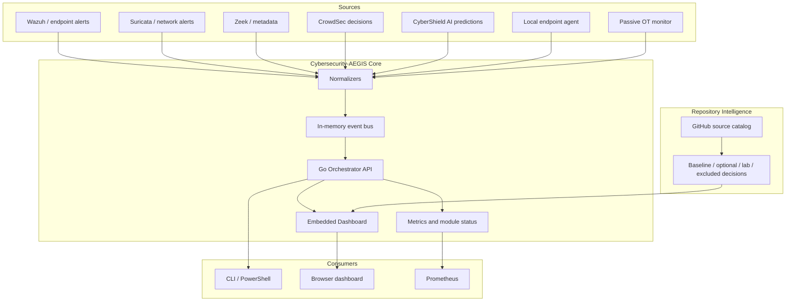

# Cybersecurity-AEGIS Architecture

Cybersecurity-AEGIS is a local-first defensive cybersecurity suite. The current
milestone provides an MVP control plane that normalizes events, exposes system
posture, serves an embedded dashboard, and keeps OT/ICS visibility safe and
passive by default.

## Design Principles

- Defensive-only: no C2, exploit automation, brute-force, or unauthorized access workflows.
- Local-first: events, secrets, and OT context stay on the operator machine unless explicitly exported.
- Composable: external tools plug in through normalized ingest contracts instead of being embedded into a monolith.
- GitHub-evidence driven: repository inclusion is based on primary repo status, license, maintenance, and fit.
- OT passive by default: industrial monitoring observes or simulates. It does not write to PLCs or enforce network changes in the MVP.
- Spec Kit governed: implementation follows `specs/001-cyberforge-mvp`.

## Logical View



## Runtime Profiles

| Profile | Purpose | Default |
| --- | --- | --- |
| `core` | Go orchestrator and embedded dashboard | opt-in |
| `storage` | PostgreSQL for later persistence | opt-in |
| `observability` | Prometheus scrape config | opt-in |
| `ml` | CyberShield AI FastAPI prediction service with NSL-KDD joblib models | opt-in |
| `industrial` | OT monitor in simulation mode + industrial site assessment API (:8097) | opt-in |
| `industrial-host` | OT passive packet capture with host networking | opt-in, advanced |

## Industrial Site Assessment

The assessment module (`modules/industrial/site_assessment`) is a separate,
deliberately narrow capability for field work on a customer plant:

```
pcap / mirror port
        │
        ▼
  PassiveAnalyzer ──► asset inventory, conversations, OT command anomalies
        │            (zero packets sent)
        ▼
   SafetyGuard ──► scope + authorization + read-only allow-list + rate limit
        │
        ├──► PortScanner (TCP connect, OT profile)
        ├──► Read-only probes (Modbus FC43, S7 SZL, ENIP ListIdentity,
        │                      BACnet ReadProperty, SNMP GET, OPC UA Hello)
        ▼
    RiskEngine (IEC 62443-3-3, Purdue, MITRE ATT&CK for ICS)
        │
        ▼
  report.py ──► Markdown / HTML / JSON  +  baseline diff
```

Design constraints encoded in code: no protocol write functions, no
exploitation, no public targets by default, and no assessment without a written
authorization reference. See `docs/industrial-site-assessment.md`.

## Data Flow

1. A module posts raw data to `/api/v1/ingest/{source}`.
2. The orchestrator maps the payload into `SecurityEvent`.
3. Events are stored in the in-memory ring buffer for the MVP.
4. `/dashboard/`, `/api/v1/events`, `/api/v1/metrics`, and `/api/v1/modules`
   expose posture.
5. CyberShield AI predictions can be posted to `/api/v1/ingest/cybershield-ai`
   and are normalized as `ml` category security events with risk severity.
6. Future releases can replace the ring buffer with PostgreSQL or OpenSearch
   without changing the ingest contract.

## AI/ML Boundary

`modules/ml/cybershield_ai` imports the supplied CyberShield AI v0.2 package as
a real MVP ML/IDS module:

- FastAPI service on port `8919`
- binary attack/benign ensemble
- attack-family classifier
- anomaly baseline model
- NSL-KDD real subset examples, manifest, and training report
- Wazuh/Zeek/Suricata/StackStorm integration examples
- production-readiness and NIS2/GDPR notes

The module is concrete enough to run locally and produce predictions, but it is
not treated as final production intelligence. Production use requires full
dataset retraining, model drift tests, artifact signing, rollback, audit logs,
and model-card review.

## OT/ICS Boundary

The industrial module recognizes OT protocols such as Modbus TCP, DNP3, IEC
61850 MMS, OPC UA, BACnet, and IEC 104. The MVP supports:

- simulation mode for development
- passive packet analysis when Scapy is available
- basic Modbus write anomaly detection
- asset discovery from observed traffic
- Purdue level context as metadata

It intentionally does not:

- send Modbus/DNP3/IEC commands
- scan industrial networks actively
- enforce firewall or segmentation changes
- auto-isolate assets

Those capabilities require separate review, explicit authorization, and a
production safety case.
